# Real Estate Acquisition Underwriting & Investment Analysis

## Park Hotels & Resorts | Public-company case study

I built this project to connect investment valuation with the questions that matter after a deal closes: how properties generate cash, how much debt that cash can support, and how operating or insurance losses affect equity value. I use Park Hotels & Resorts' public disclosures to examine a hypothetical acquisition from investment, real-estate, credit and risk perspectives.

**Excel · Python · Three-statement modeling · DCF · LBO · REIT analysis · Property valuation · Credit coverage · Insurance exposure**

[Download the Excel model](excel/Park_Acquisition_Underwriting.xlsx) · [Read my investment committee memo](docs/INVESTMENT_COMMITTEE.md) · [Sources](docs/SOURCES.md) · [Methodology](docs/METHODOLOGY.md) · [Excel guide](docs/EXCEL_GUIDE.md)

**To open Excel:** on the workbook's GitHub page, click the **download arrow next to Raw**, then open the downloaded file in desktop Excel. The previews below let you inspect every sheet without downloading.

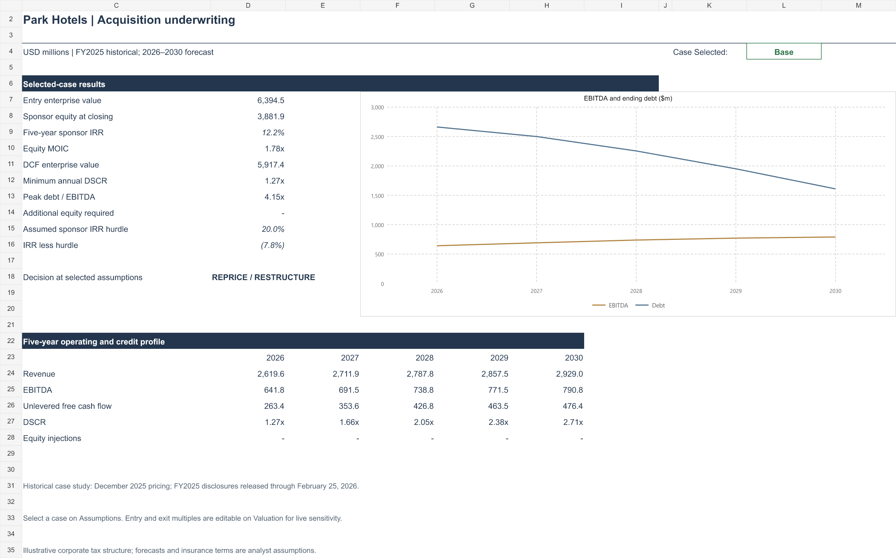

## My conclusion

**Reprice or restructure.** At the assumed 10.5x entry/exit multiples, the base case falls short of my 20% sponsor IRR hurdle. The downside requires additional equity and breaches assumed coverage and leverage thresholds. I kept that outcome visible because the purpose of underwriting is to test a transaction, not manufacture a target return.

| Case | Five-year IRR | MOIC | Minimum DSCR | Peak debt / EBITDA | Additional equity |
|---|---:|---:|---:|---:|---:|
| Base | 12.2% | 1.78x | 1.27x | 4.15x | $0.0m |
| Upside | 17.1% | 2.20x | 1.59x | 3.76x | $0.0m |
| Downside | -1.1% | 0.95x | 0.46x | 7.21x | $295.4m |


Results are illustrative, not realized. The model uses FY2025 disclosures with a February 25, 2026 information cutoff and December 31, 2025 pricing. It is a retrospective case study, not a current stock recommendation or point-in-time backtest.

## How I approached the work

- **Start with evidence.** I separated issuer financial facts, historical stock prices and my assumptions. Numerical inputs trace to a source register.
- **Connect earnings to cash.** I projected revenue, EBITDA, taxes, working capital and capex, then linked financing to the cash-flow and balance-sheet schedules.
- **Make downside funding visible.** Two debt tranches amortize and sweep cash in priority order; shortfalls generate explicit sponsor equity calls.
- **Look through to properties.** I analyzed 20 core hotels using disclosed property earnings and a reserve-adjusted NOI proxy, alongside trading comparisons and two acquisition references.
- **Translate risk into dollars.** I connected assumed property damage, business interruption and liability retentions to cash flow and debt coverage.
- **Check the model independently.** I compared Excel outputs against a separate Python engine and tested sensitivities, balance sheets, debt roll-forwards and insurance limits.

The acquisition assumes a taxable corporate structure. The property table is a gross **core-property** valuation, not whole-company NAV. The insurance module is an **owner-side stress assessment**, not insurer pricing or actuarial reserving. The model aggregates JV economics and uses a simplified purchase-basis allocation; those limits are documented in the [methodology](docs/METHODOLOGY.md).

## Workbook walkthrough

There are 13 formula-driven worksheets. Long sheets include additional section previews. These images are saved workbook renders; changing an Excel input does not update the images or this README.

<details>
<summary><strong>Selected-case decision</strong> — Returns, liquidity and the five-year operating profile.</summary>


</details>

<details>
<summary><strong>Underwriting assumptions</strong> — Editable financial and insurance inputs.</summary>

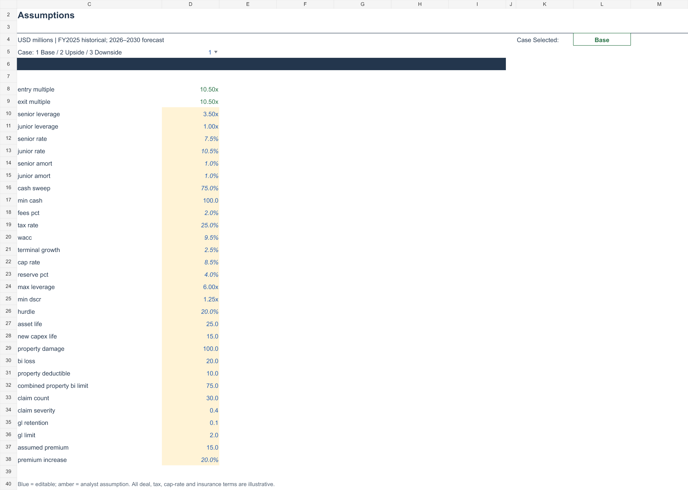

</details>

<details>
<summary><strong>Scenario drivers</strong> — One selected case flows through the model.</summary>

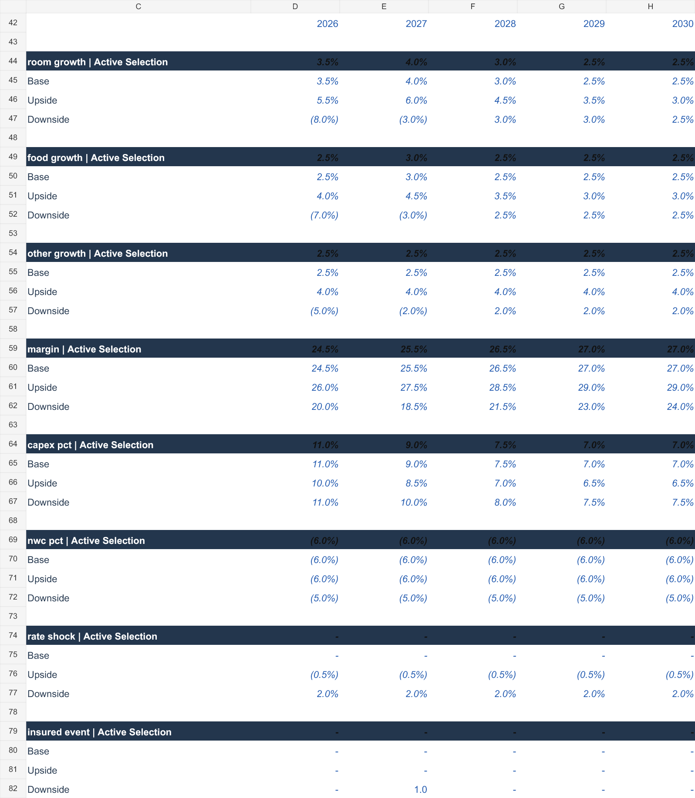

</details>

<details>
<summary><strong>Sources and uses</strong> — Purchase funding and explicit property-basis allocation.</summary>

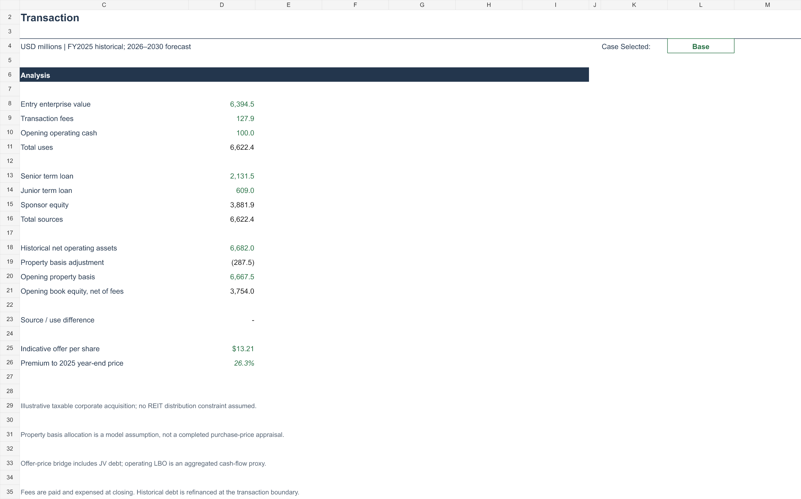

</details>

<details>
<summary><strong>Operating statement</strong> — Revenue drivers, margins, taxes and free cash flow.</summary>

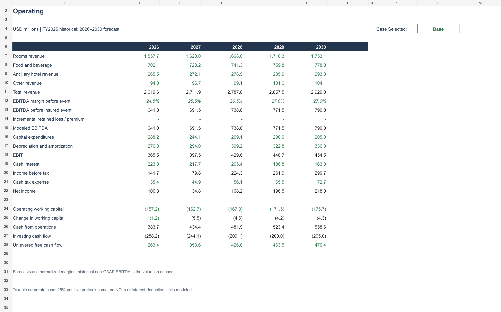

</details>

<details>
<summary><strong>Debt and coverage</strong> — Amortization, senior-first sweep, equity calls and assumed covenant headroom.</summary>

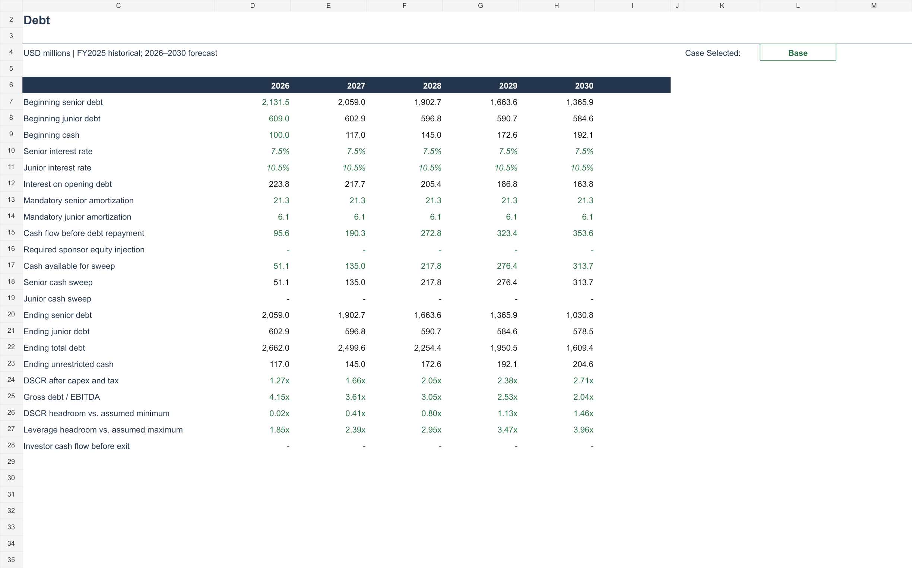

</details>

<details>
<summary><strong>Cash flow and balance sheet</strong> — Integrated schedules with visible reconciliation.</summary>

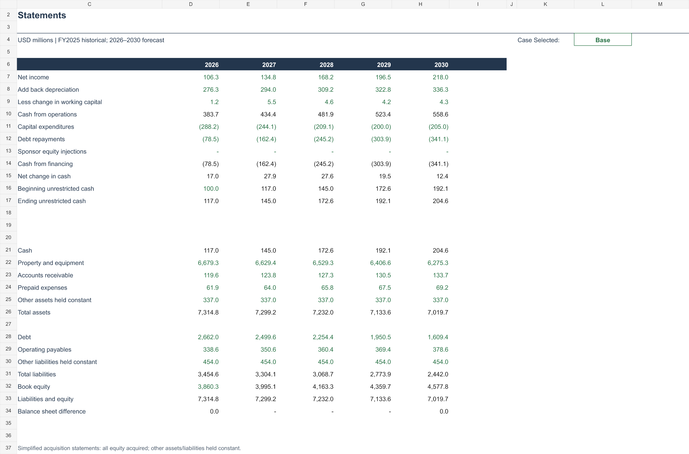

</details>

<details>
<summary><strong>DCF and LBO valuation</strong> — IRR, MOIC, return attribution and native Excel sensitivity.</summary>

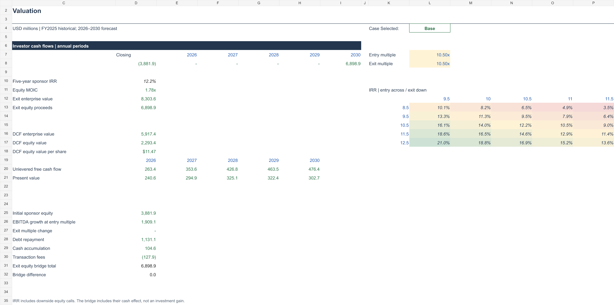

</details>

<details>
<summary><strong>Core-property valuation</strong> — 20 real hotels with reserve-adjusted earnings and illustrative cap rates.</summary>

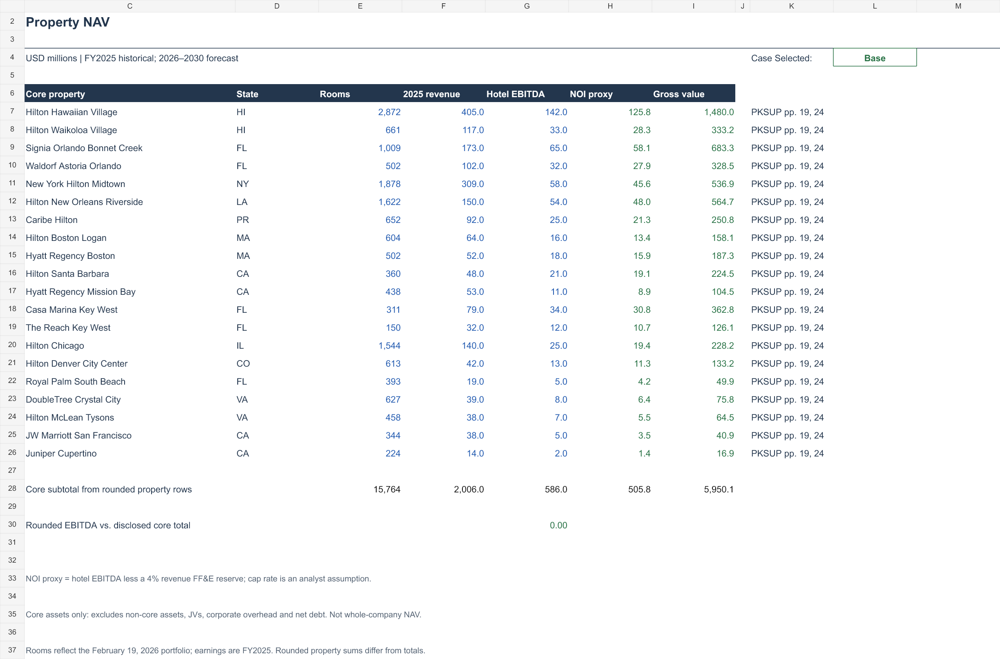

</details>

<details>
<summary><strong>Insurance cash-flow stress</strong> — Assumed coverage recoveries, retained losses and incremental premiums.</summary>

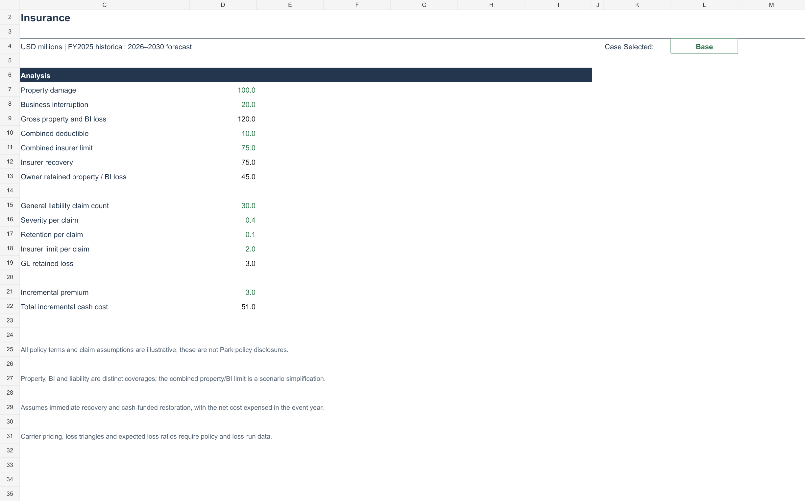

</details>

<details>
<summary><strong>Public trading comparisons</strong> — PK, HST and PEB with dated capital-structure inputs.</summary>

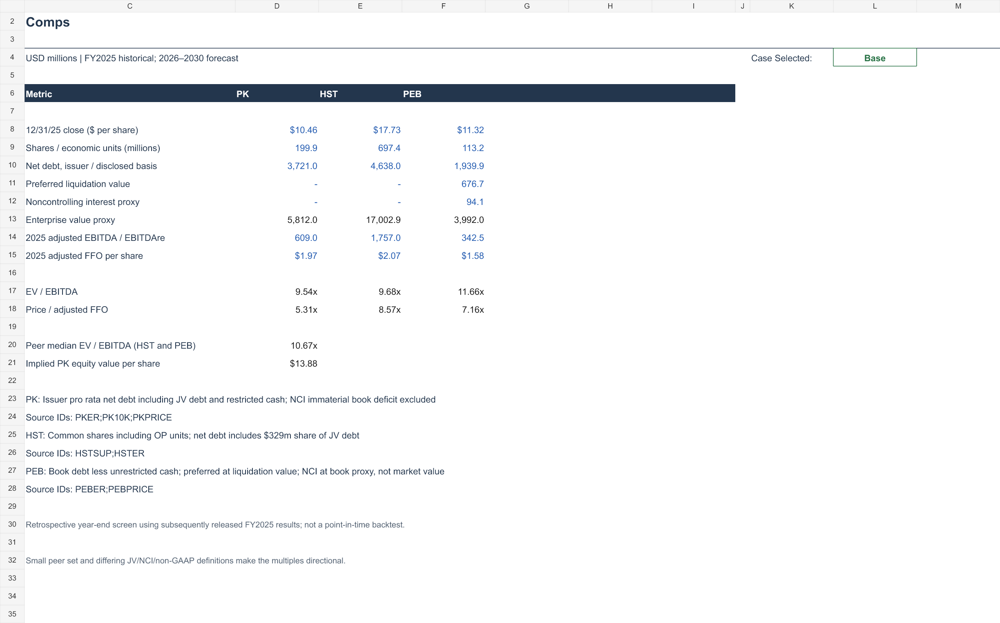

</details>

<details>
<summary><strong>Transaction references</strong> — Hersha and Watermark announced value-per-key context.</summary>

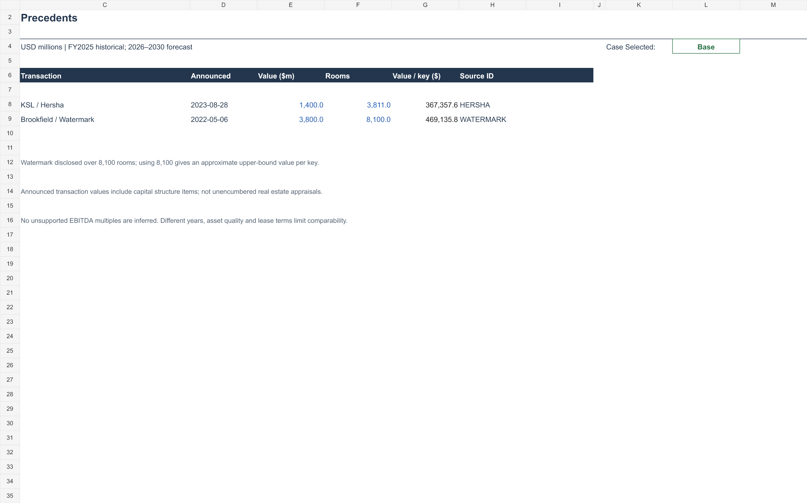

</details>

<details>
<summary><strong>Historical operating data</strong> — 2023–2025 public financial statement inputs.</summary>

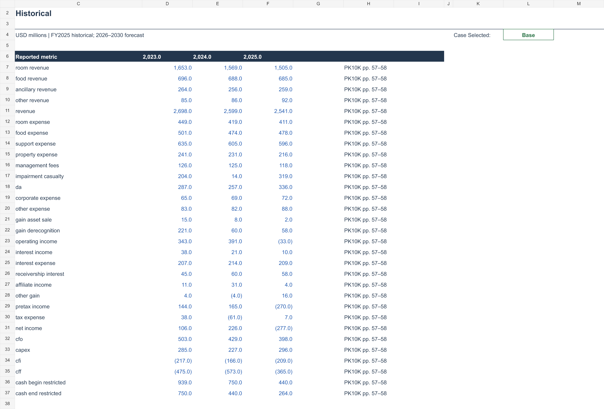

</details>

<details>
<summary><strong>Historical balance sheet inputs</strong> — 2025 balance sheet and REIT metrics.</summary>

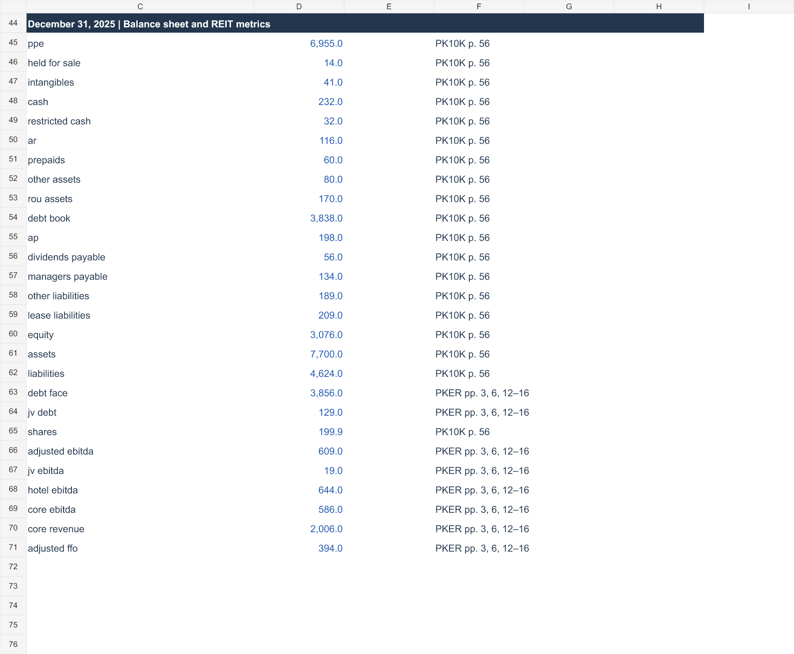

</details>

<details>
<summary><strong>Reconciliation checks</strong> — Funding, cash, debt, statements and return bridge controls.</summary>

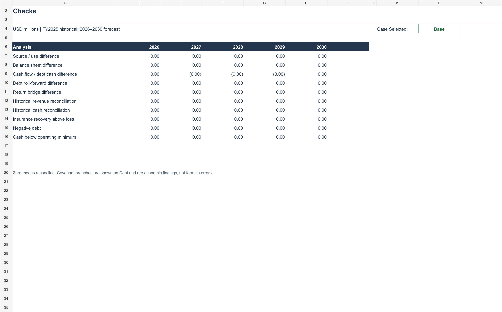

</details>


## Reproduce the analysis

Python 3.11+ is sufficient for the independent financial model; it has no third-party dependencies.

```bash
python src/model.py
python -m unittest discover -s tests -v
python src/write_docs.py
```

Curated inputs live in `data/`. `src/prepare_data.py` recreates the original public-data snapshot and resets assumptions to the delivered version; do not run it over inputs you intend to preserve. `reports/` contains generated results and workbook validation receipts.

The supplied `.xlsx` works without Python. Its authoring source, `src/build_workbook.mjs`, uses `@oai/artifact-tool` in the Codex bundled runtime. That authoring dependency is not needed to use Excel or reproduce the Python results; it must be available to regenerate the workbook and previews. After changing data: run the Python engine, rebuild the workbook in that runtime, run verification, then regenerate the memo/README.

## Files and evidence

| Folder | Contents |
|---|---|
| `excel/` | Editable 13-sheet model |
| `data/` | Historical inputs, assumptions, properties, peers and source register |
| `src/` | Independent model, workbook authoring and narrative generation |
| `tests/` | 14 financial consistency and stress tests |
| `reports/` | Scenario results and validation records |
| `docs/` | Investment memo, methodology, sources and Excel instructions |
| `assets/` | Every worksheet preview |

I use public company data and clearly labeled assumptions. This is my independent portfolio case study; it is not sponsored by Park or presented as a completed transaction or an institutional investment recommendation.
